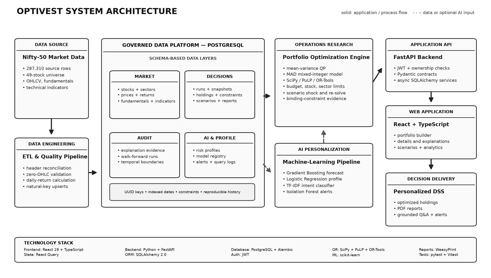
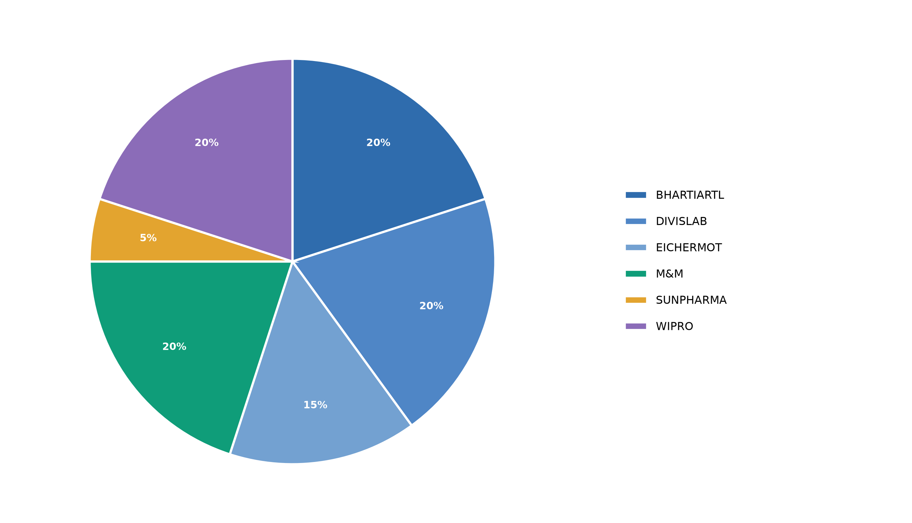
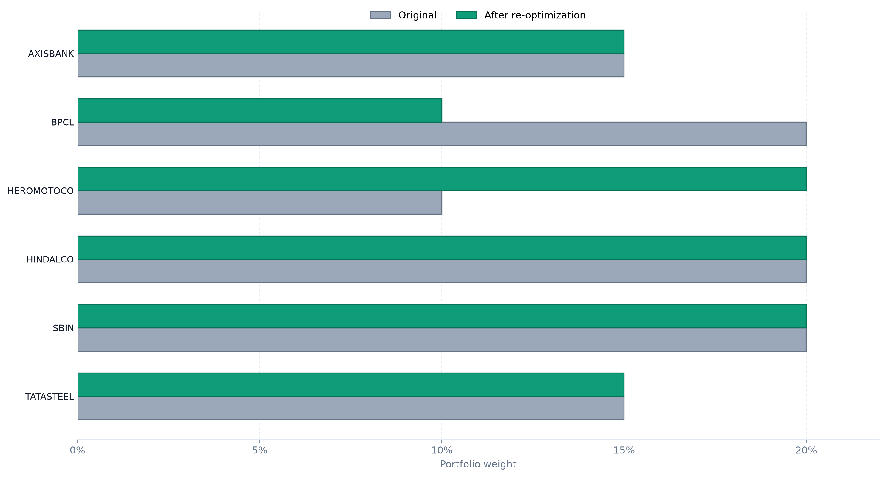
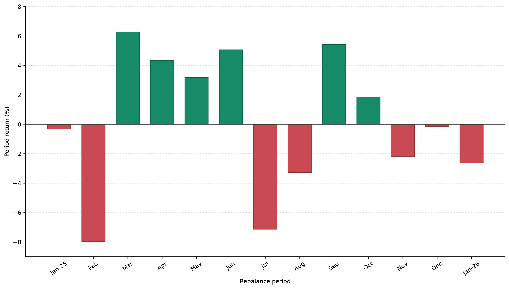

# OptiVest Presentation Visuals

This folder contains presentation-ready architecture diagrams and analytical charts for the OptiVest project. The visuals use a consistent 16:9 layout and are available as high-resolution PNG files for PowerPoint and SVG files for scalable export.

## Visual catalogue

| No. | Visual | Recommended use |
| --- | --- | --- |
| 01 | [System architecture](generated/01_system_architecture.png) | Proposed system architecture or technology workflow |
| 02 | [Portfolio allocation](generated/02_portfolio_allocation.png) | Optimized holdings and allocation discussion |
| 03 | [Market-crash reallocation](generated/03_market_crash_reallocation.png) | Scenario simulator and stress-test results |
| 04 | [Out-of-sample performance](generated/04_out_of_sample_performance.png) | Historical unseen-period validation |
| 05 | [Walk-forward comparison](generated/05_walk_forward_comparison.png) | Fixed allocation versus repeated re-estimation |
| 06 | [Walk-forward monthly returns](generated/06_walk_forward_monthly_returns.png) | Period-by-period return behaviour |
| 07 | [Daily-return distribution](generated/07_daily_returns_distribution.png) | Return distribution and downside-risk discussion |
| 08 | [Project workflow](generated/08_project_workflow.png) | Methodology or implementation workflow |
| 09 | [ML portfolio performance](generated/09_ml_portfolio_performance.png) | Historical-mean versus ML-return comparison |
| 10 | [Risk-classifier performance](generated/10_risk_classifier_performance.png) | Investor-risk classification results |
| 11 | [Out-of-sample analytics dashboard](generated/11_out_of_sample_analytics_dashboard.png) | Product demonstration or results slide |

## Preview

### System architecture



### Portfolio allocation



### Scenario reallocation



### Walk-forward monthly returns



## Regenerate the visuals

Install Matplotlib, then run the generator from the repository root:

```bash
python docs/presentation/generate_ppt_visuals.py
```

To create only one format or use another output directory:

```bash
python docs/presentation/generate_ppt_visuals.py --format png
python docs/presentation/generate_ppt_visuals.py --output-dir exported-visuals --format svg
```

The generator creates visuals 01–10. Visual 11 is a verified application capture and is intentionally retained as a PNG screenshot.

## Usage notes

- Use PNG assets when inserting directly into PowerPoint.
- Use SVG assets when resizing substantially or editing in a vector tool.
- Preserve each chart's caption and units when placing it in a report.
- Treat displayed model and portfolio metrics as results from the documented project run, not guaranteed future performance.
